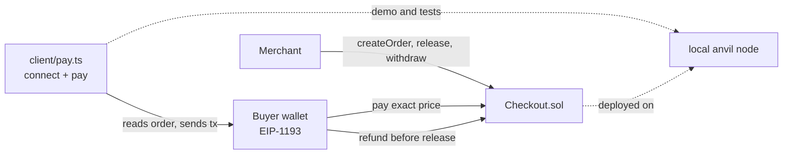

# web3-checkout-demo

A small ETH checkout escrow in Solidity (Foundry tests incl. fuzz) plus a TypeScript wallet-connect and pay client, demoed against a local anvil node. Built as a readable reference for "accept crypto payments on a store" work, with the failure modes tested rather than assumed.

> **Unaudited. Never deployed to any live chain (mainnet or testnet).** Demo code only. Do not put real funds in it. See [docs/risks.md](docs/risks.md).

## What

- `src/Checkout.sol`: the merchant creates an order with a price; a buyer pays the exact amount; the merchant releases (proceeds become a pull-payment balance, then `withdraw`) or the payer/merchant refunds before release. Merchant-only release, reentrancy guard, custom errors.
- `test/Checkout.t.sol`: the five named tests plus fuzz tests for reentrancy on refund, wrong-amount payment and double release.
- `client/`: viem-based `createPayer({provider, contractAddress})` with `connect()` (EIP-1193 wallet connect) and `pay(orderId, amountWei) -> {txHash}`, which checks the order on-chain before spending gas.

## 2-minute demo

Needs Node 20+ and Foundry (`forge`, `anvil`). No accounts, no network, no keys: anvil's throwaway dev accounts only.

```bash
git clone --recurse-submodules <this repo> && cd web3-checkout-demo
npm --prefix client ci
npm run demo
```

Output (real run, see [docs/demo-output.txt](docs/demo-output.txt)): deploys the contract, merchant creates an order, a wrong amount is refused client-side, the exact payment goes through, a second payment is refused, merchant releases and withdraws.

Tests:

```bash
forge test                    # contract: 14 tests, fuzz 512 runs each
npm --prefix client test      # client: 5 tests (3 against a spawned local anvil)
```

## Architecture



Order states: `None -> Created -> Paid -> Released | Refunded`. Release is pull-payment (merchant calls `withdraw`); refund is a push to the payer behind a reentrancy lock and checks-effects-interactions. Design notes: [docs/design.md](docs/design.md).

## Verified vs NOT verified

Verified (run on this machine, 2026-10-29):

- `forge test` (Foundry 1.8.6, solc 0.8.24): 14/14 pass, fuzz tests at 512 runs. Tests were written first and run red (compile failure, no contract yet) before the implementation.
- Client unit and integration tests (vitest) pass, including pay flow, wrong amount and already-paid refusals against a spawned local anvil 1.8.6.
- `npm run demo` runs end to end against a local anvil node.
- Client typecheck and eslint pass.

NOT verified:

- Any run on a live chain or public testnet. The contract has never been deployed anywhere.
- Any independent audit, Slither/Mythril static analysis, formal verification, or invariant-test campaign.
- A real browser wallet (MetaMask etc.). Wallet connect is the EIP-1193 interface, exercised through an HTTP shim over anvil's unlocked accounts.
- Other EVM chains or L2s, token (ERC-20) payments, gas-cost optimisation.
- GitHub Actions CI has not run yet (the repo has not been pushed).

Toolchain note: Foundry was installed from the official prebuilt Windows release for this run; Hardhat is not used.

## Licence

MIT, see [LICENSE](LICENSE).
